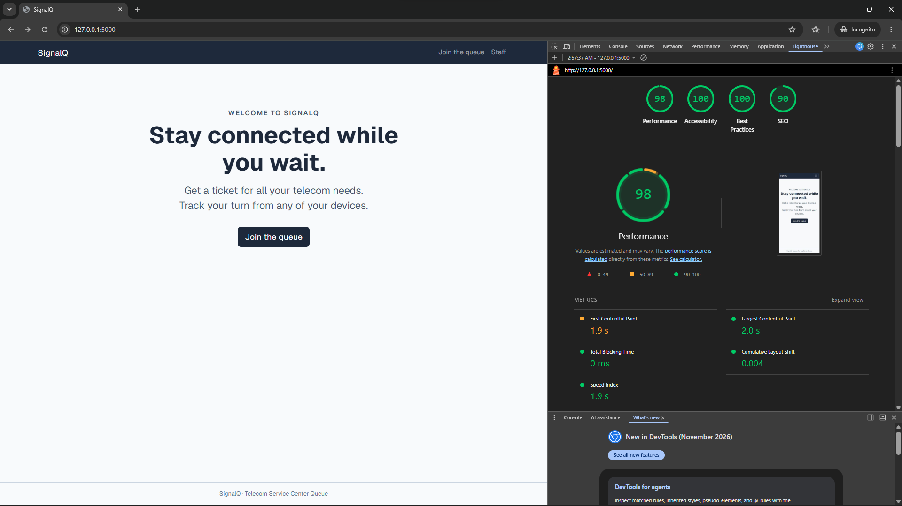
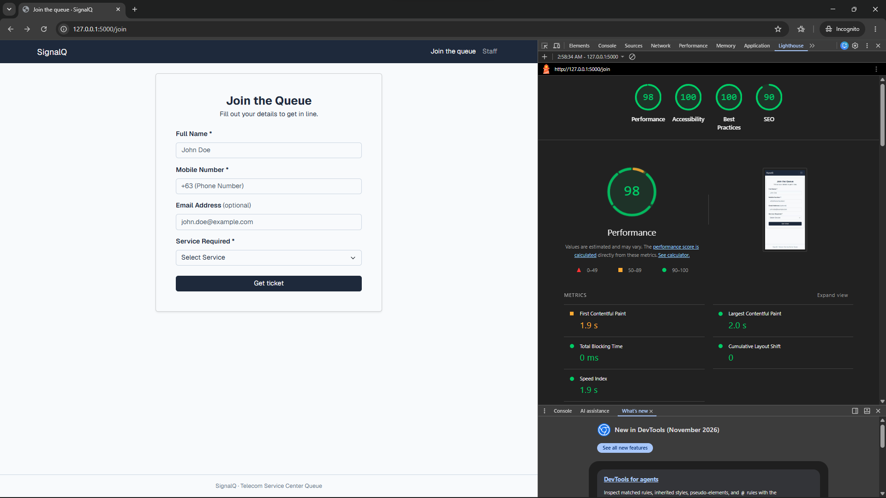
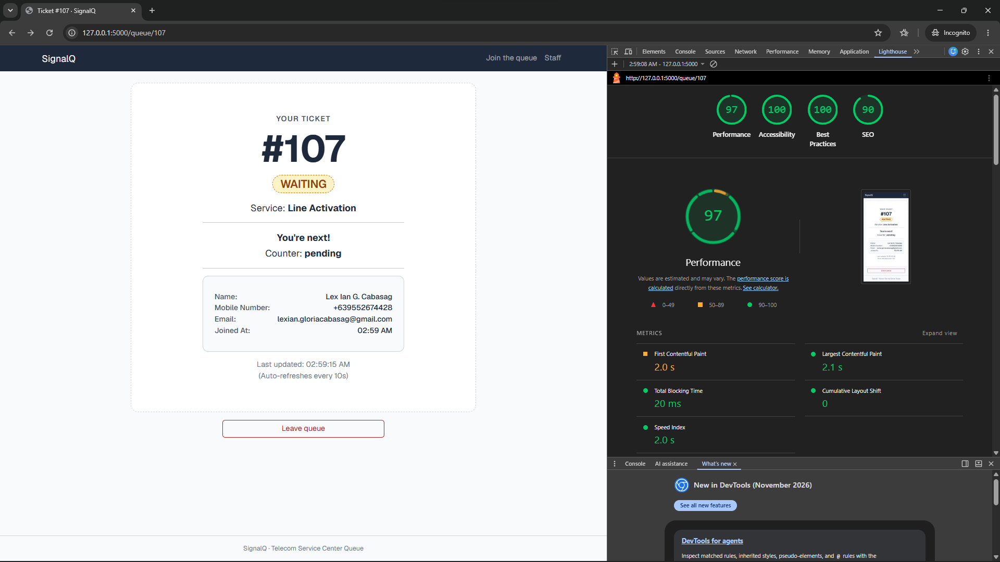
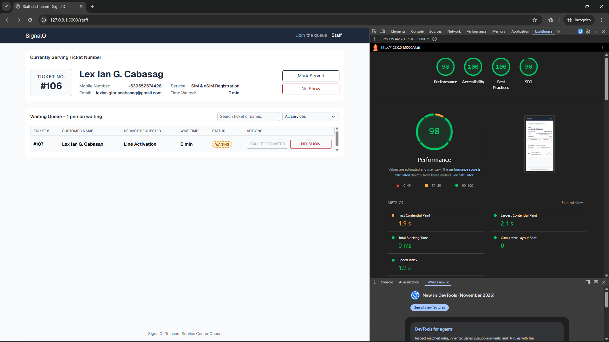

# Accessibility check

## 9a. Lighthouse

| Screen | Screenshot | Main issues fixed |
| --- | --- | --- |
| Home Page |  | No Issue |
| Join |  | No Issue |
| My place |  | No Issue |
| Staff dashboard |  | No Issue |

## 9b. Keyboard only test

| Task | Result | Notes |
| --- | --- | --- |
| Join from the home page | ✅ | Using only the keyboard (Tab, Shift+Tab, Enter, Space and the arrow keys), I completed the join flow. The skip link appeared on the first Tab press, and the focus outline was visible at every step. |
| Staff filter, call and serve | ✅ | I reached the service filter and every button with Tab and Shift+Tab, and I activated them with Enter. |
| What failed and how I fixed it | None | None of my screens failed. |

## 9c. Manual checklist

| Check | Join | My place | Staff |
| --- | --- | --- | --- |
| Every input has a visible label | ✅ | ✅ | ✅ |
| Error messages say what to do, in text | ✅ | ✅ | ✅ |
| Status is shown in words, not only color | ✅ | ✅ | ✅ |
| Readable at 375 px with no sideways page scroll | ✅ | ✅ | ✅ |
| Buttons at least about 44 × 44 px | ✅ | ✅ | ✅ |
| Page has one `<h1>` and headings in order | ✅ | ❌  | ✅ | 
| `<html lang="en">` (or your language) is set | ✅ | ✅ | ✅ | 

**Fixes made from the checklist:** `ticket.html` did not have an `<h1>`, so I changed the ticket number from a `
` to an `<h1>`.