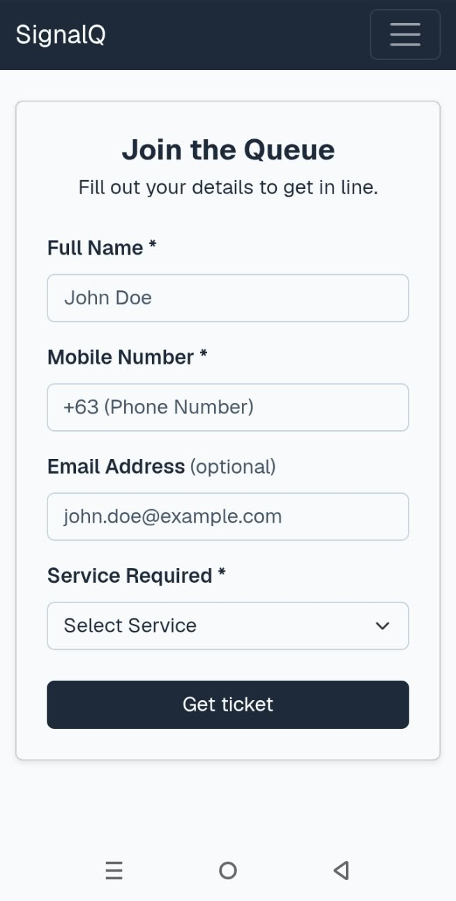
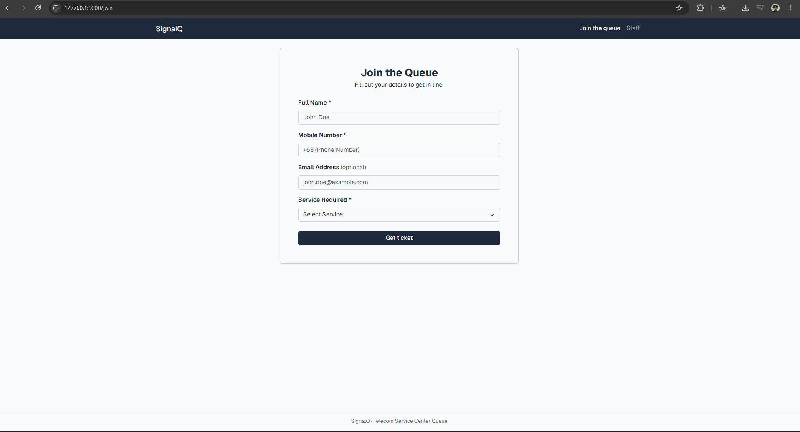
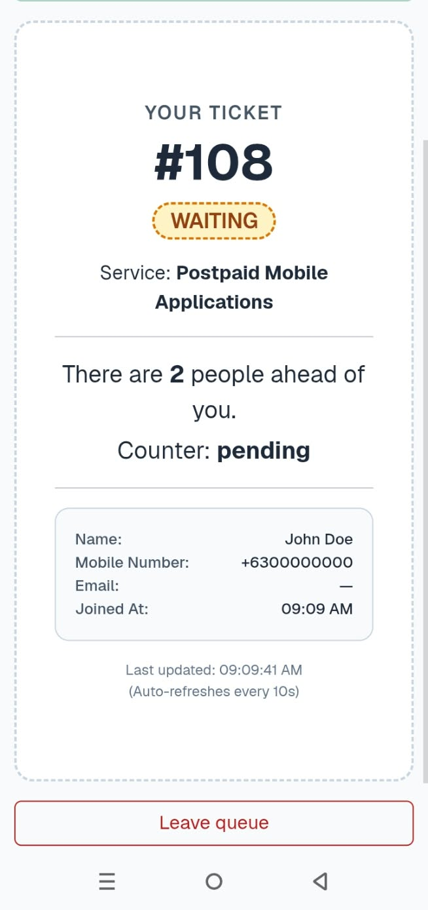
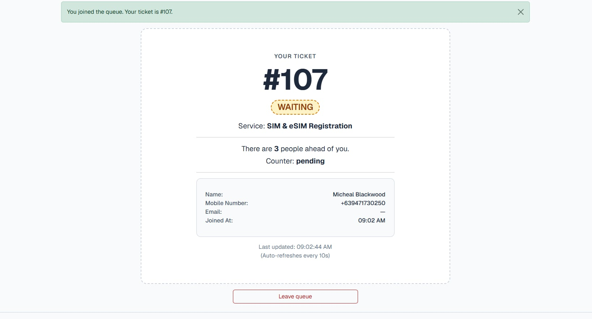
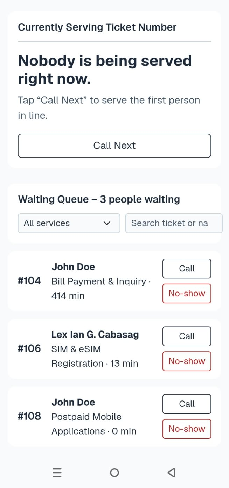
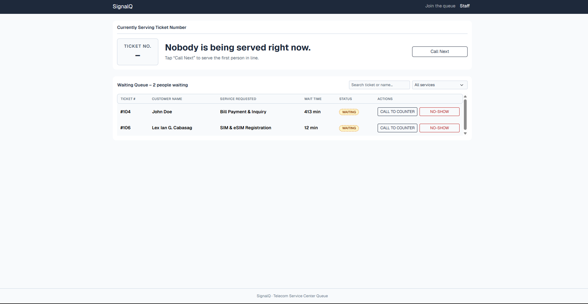
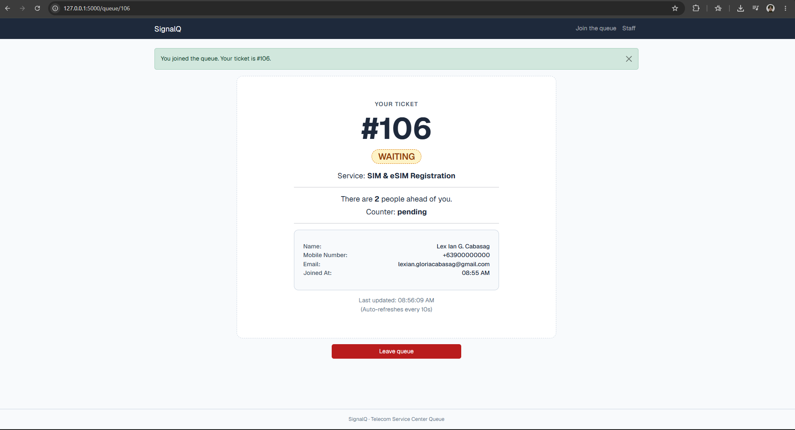
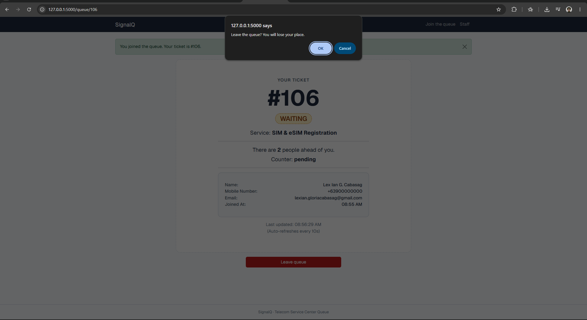

# Week 3 Report: SignalQ

## Title details

| | |
| --- | --- |
| **App name** | SignalQ |
| **Setting** | Telecom service center (SIM registration, SIM replacement, line activation, postpaid and fiber applications, bill payment, technical support) |
| **Full name** | Lex Ian G. Cabasag |
| **Student ID** | 2024-0480 |
| **Section** | CS3B |
| **Date** | October 25, 2026 |
| **Pull request** | [Link to your pull request] |

## Personas

Full personas: [docs/week3/personas.md](personas.md)

**Joanna Sanchez, the person waiting.** 44, owner of a sari-sari store that earns most of its money from prepaid load. She uses her phone with one hand while holding her bag.

> "Whenever I go to a service center to get help for my retailer SIM, I have to go through a lengthy process, and I'm not even sure how many people are ahead of me, or if I can step out for a moment."

| Task | Screen | Requirement ID |
| --- | --- | --- |
| Pick the right service and join the queue | Join | FR-01 |
| Check ticket number, service, status and position | My place | FR-02 |
| See the assigned counter once called | My place | FR-02 |
| Leave the queue if the store needs her | My place | FR-03 |

**Michael Blackwood, the staff member.** 34, Senior Customer Service Representative at Counter 2, working on a desktop PC all day.

> "I feel like it would be easier if I could see ticket details. Like seeing 'Ticket 304' is here for SIM registration or a bill payment would be a helpful detail. It gives me immediate context on what to prepare for."

| Task | Screen | Requirement ID |
| --- | --- | --- |
| See each waiting ticket's number, service and status | Staff dashboard | FR-04 |
| Call the next ticket to his counter | Staff dashboard | FR-05 |
| Mark a ticket as served | Staff dashboard | FR-05 |
| Mark a ticket as a no-show | Staff dashboard | FR-05 |

## Screens

| Screen | Screenshot | Who uses it and requirements |
| --- | --- | --- |
| Join the queue |  | Joanna uses this on her phone to get a ticket for the service she needs (FR-01). |
| Join the queue |  | The same form on a laptop, where it narrows to a centered card (FR-01). |
| My place |  | Joanna checks her ticket number, status, position and counter here while waiting (FR-02, FR-03). |
| My place |  | The same page on a laptop, with the same information in a wider card (FR-02, FR-03). |
| Staff dashboard |  | Michael can use the phone layout, where each waiting ticket is a row with Call and No-show buttons (FR-04, FR-05). |
| Staff dashboard |  | Michael's main view at Counter 2: the currently serving panel and the waiting table (FR-04, FR-05). |

## Design decisions

1. **The service is shown next to every ticket number on the staff dashboard.**   For Michael, knowing "Ticket 304 is for SIM registration" gives him context on what to prepare, and he often spends about 10 minutes before realizing a customer is at the wrong counter (Michael, rule 1). The "Currently Serving" panel and the waiting table both show the service name.
2. **My place shows position as a plain sentence and refreshes by itself.**   Joanna cannot tell how many people are ahead of her from the "Now Serving" display, and she may step out to check her store (Joanna, rules 1 and 2). The page says "There are 5 people ahead of you" in words, shows a "last updated" time, and updates every 10 seconds without a reload.
3. **The join form requires choosing a specific service, and the choice follows the ticket.**   Joanna wants her problem treated as what it is (Joanna, rule 5), so the service is a required field checked on the server, and it appears on her ticket and on her row in the staff dashboard.

## Self-review

Full review: [docs/week3/feedback.md](feedback.md)

| Screen | Main finding | Change |
| --- | --- | --- |
| Join | The form has one job, each field has its own labeled row, and the full-width **Get ticket** button is easy to hit one-handed. It follows Joanna's rules 4 and 5. I found no problem for her. | None. Both frames kept. |
| My place | The ticket number is the biggest element, and the position sentence, counter, last-updated line and Leave queue button follow Joanna's rules 1 to 3. **Problem:** her rule 2 asks for the status and counter in large text, but in the frames both were small next to the ticket number. She checks her phone one-handed, at arm's length, so she needs more margin when she is called (visibility of system status). | Made the status and the counter larger. Everything else kept. |
| Staff dashboard | **Call Next** comes first on the Currently Serving card, and every row shows the service next to the ticket number, so Michael can prepare before calling (his rules 1 and 2). Served and No-show sit on the called ticket (rule 3), and no menus are hidden (rule 4). I found no problem. | None. All three staff frames kept on phone and laptop. |

## Accessibility

Full results: [docs/week3/accessibility.md](accessibility.md)

| Screen | Lighthouse accessibility score |
| --- | --- |
| Join | 100 |
| My place | 100 |
| Staff dashboard | 100 |

**Most important issue fixed:** the My place page had no `<h1>`, because the ticket number was a `
`. I changed it to an `<h1>` so the page has one top-level heading and screen reader users can find it. The look did not change.

The keyboard-only test passed on all screens. The skip link appeared on the first Tab, focus was visible at every step, and every element could be reached and used.

## Usability test

Full notes: [docs/week3/usability-test.md](usability-test.md)

TJ tested the app [on a phone / on a laptop]. He acted as both personas but is closer to Michael. He is not a CCC181 classmate. No full name or face is recorded.

| Task | Finished? | Time | Notes |
| --- | --- | --- | --- |
| 1. Get in line for [service] | Yes | about 7-10s | He found the Join button and completed the form without hesitation or help. |
| 2. Find how many people are ahead and his ticket number | Yes | about 3s | He went straight to the large ticket number and the "people ahead" sentence. |
| 3. As staff, call the next person and mark them as served | Yes | about 5s | He found Call Next at the top of the dashboard and completed the task with no wrong clicks. |

No task caused trouble, so I chose the improvement from the gaps between my personas and the app.

**Problem:** Michael's rule 3 and Joanna's rule 3 both ask for a confirmation before an outcome becomes final. Leave queue and No-show were single clicks that could not be undone, so a mis-tap on a phone or a busy counter would remove a ticket.

**Fix:** I added a confirmation dialog to the Leave queue button and to all No-show buttons (serving panel, laptop table and phone list). Mark Served and Call stay one click because Michael repeats them all day.

| Before | After |
| --- | --- |
|  |  |

## Reflection

**Hardest part:** The queue of staff members was the most challenging task during the week. The most challenging thing about the logic was the way it was implemented: the dashboard should be able to distinguish between the ticket currently being served and those who are left in the queue, to serve just one ticket at a time, as well as to retain functionality of the filters and search in the process. The display of the queue proved to be more difficult than I initially thought since it is shown in two versions: a table on a computer screen and rows on a phone.

**What I will change in Week 4:** In Week 4 I will move the tickets from a Python list into a persistent database, so they are saved even when the server restarts. I will also improve the UI design. The queue was the hardest part this week, so I want to make the staff dashboard simpler and cleaner, and make the status and counter on the ticket page easier to read at a glance.

## Declaration

I used Claude (Anthropic) for formatting my Markdown documents and tables, for explaining code snippets, and for occasional bug fixes. I guided it using my wireframes and my own understanding of the app, and I always checked what it changed before committing it. I also used ProWritingAid to check the grammar and style of my written documents. The personas, wireframes, design decisions, test results and reflections are my own work.