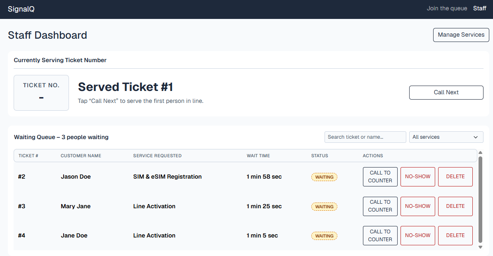
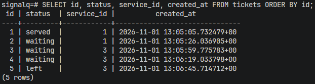
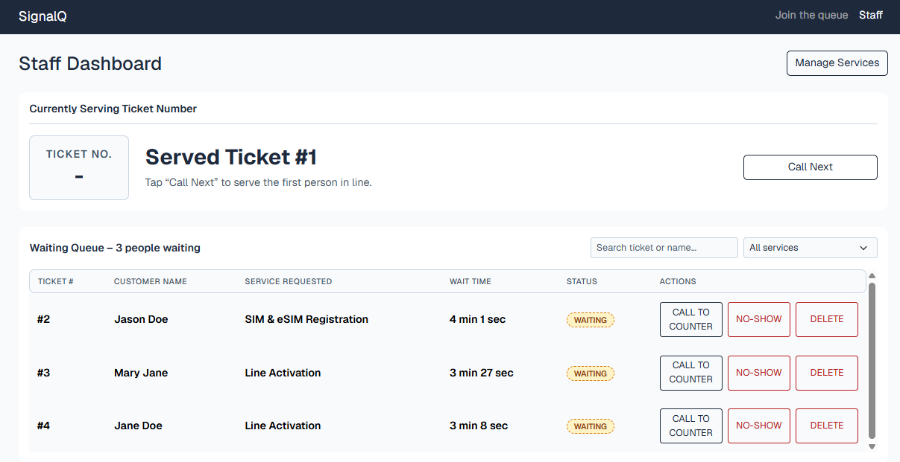
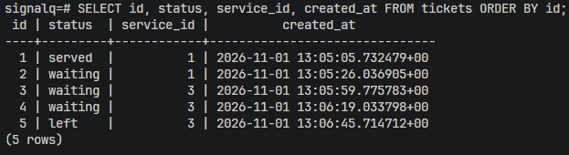
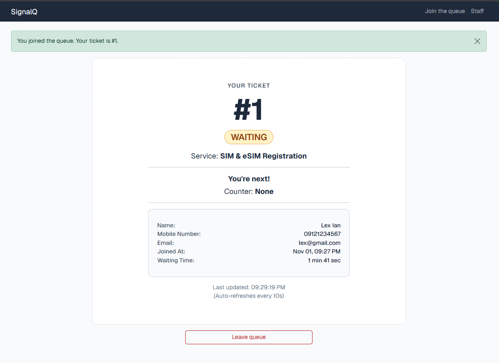
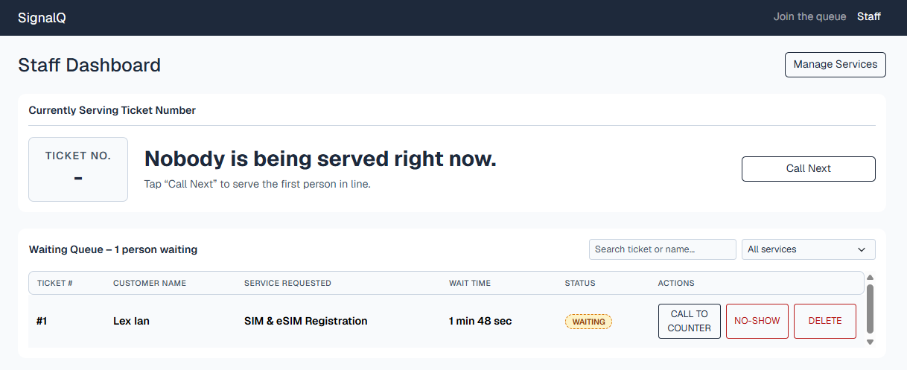
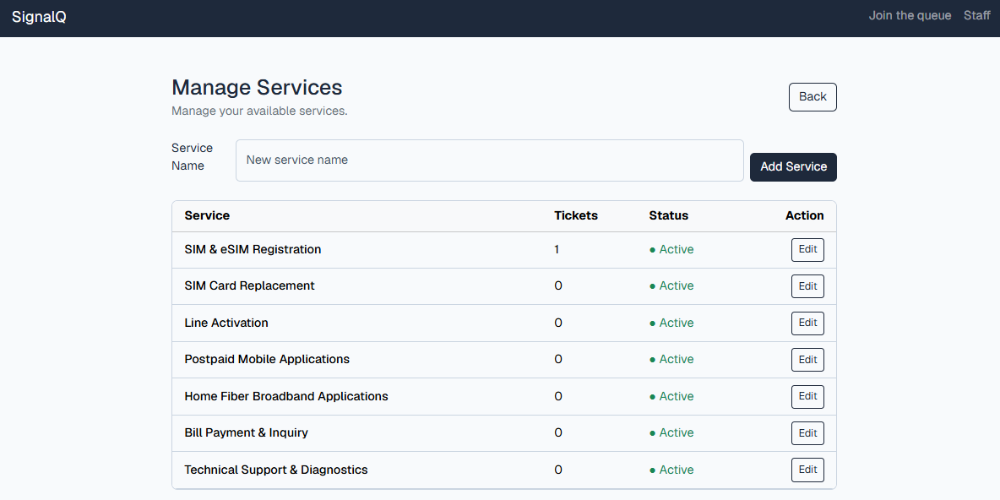

# SignalQ — Week 4 Persistence Test

## 11a. Database Restart Test

| Step | Action | Evidence / Result |
|---|---|---|
| 1 | Created at least five tickets across two services. Called one, served one, and had one customer leave. | Completed |
| 2 | Checked the Staff Dashboard and ticket records before restarting. |   |
| 3 | Stopped Flask using `Ctrl+C`, then ran `docker compose down`. Checked `docker compose ps`. | <pre>docker compose down&#10;[+] down 2/2&#10; ✔ Container signalq-db Removed&#10; ✔ Network ccc181_default Removed&#10;&#10;docker compose ps&#10;NAME    IMAGE    COMMAND    SERVICE    CREATED    STATUS    PORTS</pre> |
| 4 | Ran `docker compose up -d`, confirmed PostgreSQL was healthy, and restarted Flask. | <pre>docker compose up -d&#10;[+] up 2/2&#10; ✔ Network ccc181_default Created&#10; ✔ Container signalq-db Started&#10;&#10;docker compose ps&#10;NAME         IMAGE         SERVICE   STATUS&#10;signalq-db   postgres:17   db        Up (healthy)</pre> |
| 5 | Checked the same Staff Dashboard and ticket records after restarting. |   |

**Result**: SignalQ successfully preserved all ticket records, statuses, and timestamps after restarting Flask and PostgreSQL, showing that no data was lost. This also passed the NFR-01 requirement of `No ticket is lost on restart`.

## 11b. Rebuild From Scratch

### Rebuild Results

| Verification | Result / Evidence |
|---|---|
| Database tables | PostgreSQL confirmed that the database tables were recreated.<pre>signalq=# \dt              List of relations  Schema &#124;      Name       &#124; Type  &#124;  Owner --------+-----------------+-------+---------  public &#124; alembic_version &#124; table &#124; signalq  public &#124; services        &#124; table &#124; signalq  public &#124; tickets         &#124; table &#124; signalq  public &#124; users           &#124; table &#124; signalq (4 rows)</pre> |
| Seed data | All seven telecommunications services were restored.<pre>signalq=# SELECT id, name FROM services ORDER BY id;  id &#124; name ----+-----------------------------------  1 &#124; SIM &amp; eSIM Registration  2 &#124; SIM Card Replacement  3 &#124; Line Activation  4 &#124; Postpaid Mobile Applications  5 &#124; Home Fiber Broadband Applications  6 &#124; Bill Payment &amp; Inquiry  7 &#124; Technical Support &amp; Diagnostics (7 rows)</pre> |
| Join Queue | Successfully joined the queue and created ticket **#1** for **SIM & eSIM Registration**.    |
| Staff Dashboard | Ticket **#1** appeared in the waiting queue with the correct customer name, service, and status.    |
| Manage Services | All seven services appeared as active, and SIM & eSIM Registration showed one ticket.    |
