# SignalQ — Week 4 Database Report

## 1. Title Details

| | | 
| --- | --- |
| **App name** | SignalQ |
| **Setting** | Telecom service center (SIM registration, SIM replacement, line activation, postpaid and fiber applications, bill payment, technical support) |
| **Full name** | Lex Ian G. Cabasag |
| **Student ID** | 2024-0480 |
| **Section** | CS3B |
| **Date** | November 1, 2026 |
| **Pull Request** | [PR link] |

## 2. Requirements

SignalQ has **12 functional requirements (FR-01 to FR-12)** and **9 non-functional requirements (NFR-01 to NFR-09)**.

**MVP:** FR-01 to FR-07, FR-12, NFR-01 to NFR-04, and NFR-06 to NFR-08. It is the smallest version of SignalQ that allows telecom customers to join a queue, view their ticket status and position, and leave when necessary, while staff can manage tickets and services through a reliable database that preserves records after restarting.

**Feedback from a person in the setting:** Tester of the MVP did not have any trouble in navigating the application. However, he did tell me that customers should also have a view of their own waiting time.

**Changes made:** Based on this feedback, I revised FR-02 so that the My place page shows how long the customer has been waiting, in addition to their ticket number, service, status, position, and assigned counter.

See [Requirements](../requirements.md).

## 3. Entity Relationship Diagram (ERD)

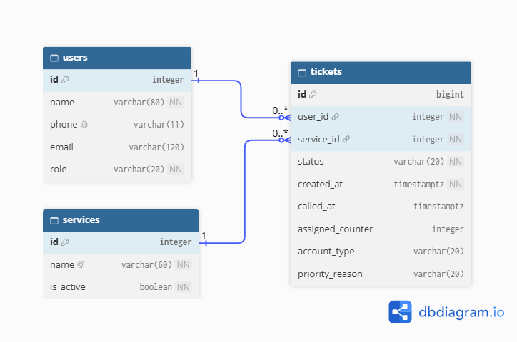

SignalQ has three related tables:

- **Users → Tickets (1:N):** One customer can have multiple tickets over time, but each ticket belongs to one customer.
- **Services → Tickets (1:N):** One service can have multiple tickets, but each ticket belongs to one service.

See [Database Schema](schema.md).

## 4. Database Schema

The following table definitions were inspected using PostgreSQL's `\d` command.

### Users

```text
                                  Table "public.users"
 Column |          Type          | Collation | Nullable |            Default            
--------+------------------------+-----------+----------+-------------------------------
 id     | integer                |           | not null | generated always as identity
 name   | character varying(80)  |           | not null | 
 phone  | character varying(11)  |           |          | 
 email  | character varying(120) |           |          | 
 role   | character varying(20)  |           | not null | 'customer'::character varying
Indexes:
    "users_pkey" PRIMARY KEY, btree (id)
    "users_phone_key" UNIQUE CONSTRAINT, btree (phone)
Check constraints:
    "ck_users_customer_phone_required" CHECK (role::text = 'staff'::text OR phone IS NOT NULL)
    "ck_users_email_format" CHECK (email IS NULL OR email::text ~ '^[^@[:space:]]+@[^@[:space:]]+$'::text)
    "ck_users_name_not_blank" CHECK (btrim(name::text) <> ''::text)
    "ck_users_phone_format" CHECK (phone IS NULL OR phone::text ~ '^09[0-9]{9}$'::text)
    "ck_users_role" CHECK (role::text = ANY (ARRAY['customer'::character varying, 'staff'::character varying]::text[]))
Referenced by:
    TABLE "tickets" CONSTRAINT "tickets_user_id_fkey" FOREIGN KEY (user_id) REFERENCES users(id) ON DELETE RESTRICT
```

### Services

```text
                                 Table "public.services"
  Column   |         Type          | Collation | Nullable |           Default            
-----------+-----------------------+-----------+----------+------------------------------
 id        | integer               |           | not null | generated always as identity
 name      | character varying(60) |           | not null | 
 is_active | boolean               |           | not null | true
Indexes:
    "services_pkey" PRIMARY KEY, btree (id)
    "services_name_key" UNIQUE CONSTRAINT, btree (name)
    "unique_service_name_ci" UNIQUE, btree (lower(name::text))
Check constraints:
    "services_name_not_blank" CHECK (btrim(name::text) <> ''::text)
Referenced by:
    TABLE "tickets" CONSTRAINT "tickets_service_id_fkey" FOREIGN KEY (service_id) REFERENCES services(id) ON DELETE RESTRICT
```

### Tickets

```text
                                      Table "public.tickets"
      Column      |           Type           | Collation | Nullable |           Default            
------------------+--------------------------+-----------+----------+------------------------------
 id               | bigint                   |           | not null | generated always as identity
 user_id          | integer                  |           | not null | 
 service_id       | integer                  |           | not null | 
 status           | character varying(20)    |           | not null | 'waiting'::character varying
 created_at       | timestamp with time zone |           | not null | now()
 called_at        | timestamp with time zone |           |          | 
 assigned_counter | integer                  |           |          | 
 account_type     | character varying(20)    |           |          | 
 priority_reason  | character varying(20)    |           |          | 
Indexes:
    "tickets_pkey" PRIMARY KEY, btree (id)
    "unique_active_ticket_per_user" UNIQUE, btree (user_id) WHERE status::text = ANY (ARRAY['waiting'::character varying, 'called'::character varying]::text[])
Check constraints:
    "ck_tickets_account_type" CHECK (account_type IS NULL OR (account_type::text = ANY (ARRAY['prepaid'::character varying, 'postpaid'::character varying, 'business'::character varying]::text[])))
    "ck_tickets_assigned_counter_positive" CHECK (assigned_counter IS NULL OR assigned_counter > 0)
    "ck_tickets_priority_reason" CHECK (priority_reason IS NULL OR (priority_reason::text = ANY (ARRAY['senior citizen'::character varying, 'PWD'::character varying, 'pregnant'::character varying]::text[])))
    "ck_tickets_status" CHECK (status::text = ANY (ARRAY['waiting'::character varying, 'called'::character varying, 'served'::character varying, 'no-show'::character varying, 'left'::character varying]::text[]))
    "ck_tickets_waiting_not_called" CHECK (status::text <> 'waiting'::text OR called_at IS NULL AND assigned_counter IS NULL)
Foreign-key constraints:
    "tickets_service_id_fkey" FOREIGN KEY (service_id) REFERENCES services(id) ON DELETE RESTRICT
    "tickets_user_id_fkey" FOREIGN KEY (user_id) REFERENCES users(id) ON DELETE RESTRICT

```

## 5. Design Decisions

**Decision 1 — Preserve ticket history**

The foreign keys use `ON DELETE RESTRICT` to prevent deleting users or services that have associated tickets. This preserves information needed for reporting.

**Decision 2 — Compute queue position**

SignalQ calculates queue position using waiting tickets from the same service, ordered by `created_at` and ticket ID. Position is not stored into a column because it changes whenever the queue changes.

**Decision 3 — Prevent duplicate active tickets**

A partial unique index on `tickets.user_id` prevents a customer from holding multiple active tickets while still allowing them to join again after completing a previous visit.

## 6. Schema Self-Review

During the schema review, I identified and addressed several issues:

- Duplicate active tickets for the same customer.
- Invalid or whitespace-only customer and service names.
- Invalid email formats.
- Waiting tickets containing call information.
- Duplicate service names that differ only in capitalization.

These changes improved data integrity and reduced the possibility of inconsistent queue records.

See [Schema Self-Review](schema-review.md).

## 7. Database Migrations

| Migration | Purpose |
|---|---|
| a7d22de3127f_initial_tables.py | Created the `users`, `services`, and `tickets` tables, relationships, and initial constraints. |
| a0499df6bfef_add_case_insensitive_unique_service_.py | Added case-insensitive uniqueness for service names using `lower(name)`. |
| ed781973f935_prevent_blank_service_names.py | Added a CHECK constraint to reject empty or whitespace-only service names. |


## 8. CRUD Operations

| Operation | Route | Requirement | Evidence |
|---|---|---|---|
| Create | `POST /join` | FR-01 | 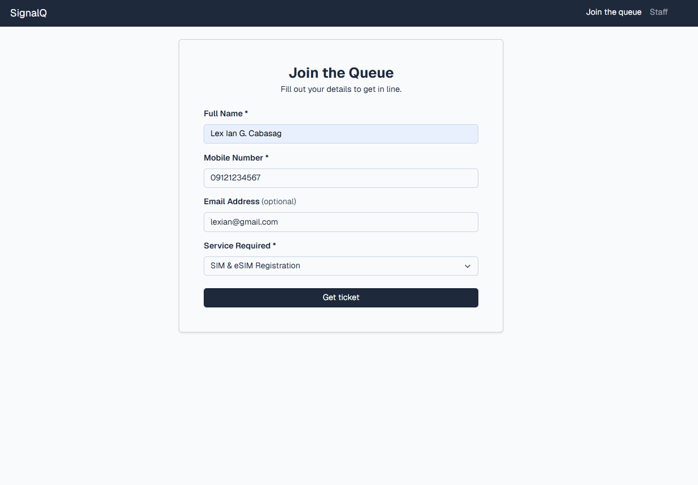 |
| Read | `GET /queue/<ticket_id>` | FR-02 | 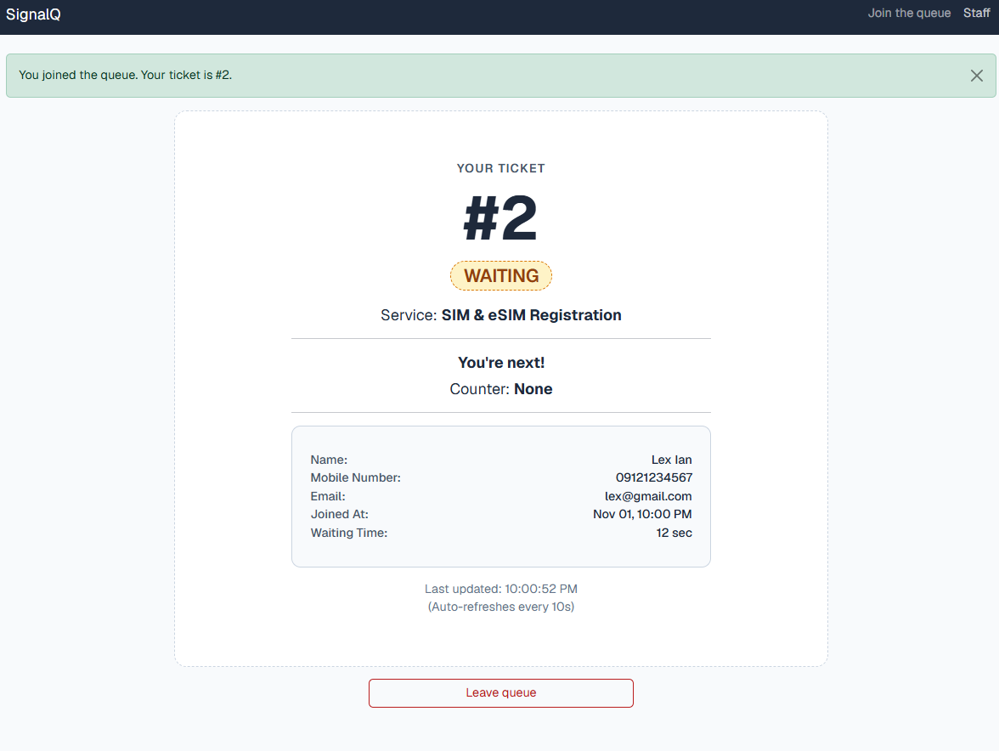 |
| Update | `POST /staff/tickets/<ticket_id>/serve` | FR-06 | 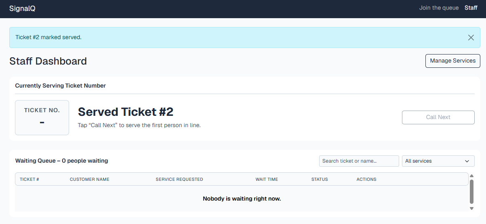 |
| Soft Delete | `POST /queue/<ticket_id>/leave` | FR-03 | 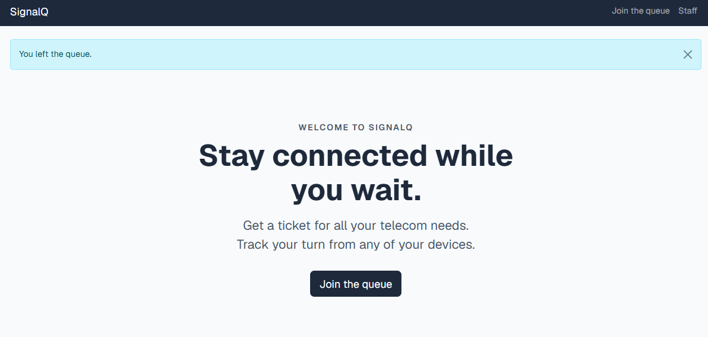 |
| Hard Delete | `POST /staff/tickets/<ticket_id>/delete` | FR-12 | 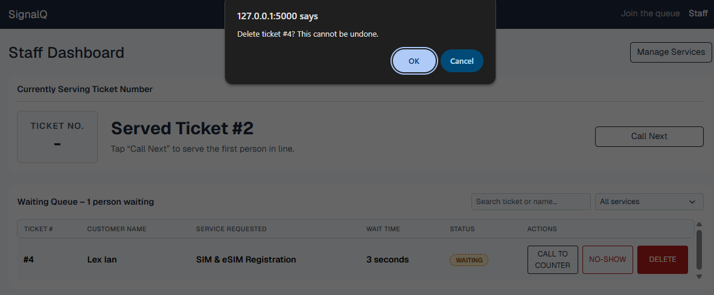 |
| Manage Services | `POST /staff/services/create` | FR-07 | 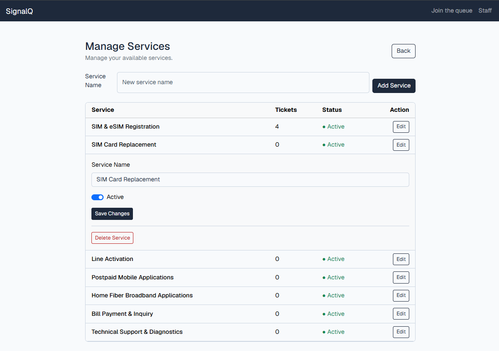 |


The application uses PostgreSQL through SQLAlchemy for its create, read, update, and delete operations.

## 9. Validation

SignalQ uses three validation layers:

- **Browser:** HTML form attributes such as `required`, `maxlength`, and `type="email"`.
- **Flask:** Server-side validation rejects invalid requests, including malformed input and inactive services.
- **PostgreSQL:** Database constraints enforce foreign keys, uniqueness, valid values, and deletion restrictions.

Three invalid Flask requests returned HTTP 400, and PostgreSQL rejected the six invalid operations, tested in Part 10b and 10c.

**Most useful error:** The `unique_active_ticket_per_user` violation demonstrated that a customer cannot hold two active tickets, even when requests bypass Flask.

See [Validation Results](validation.md).

## 10. Persistence

### Before Restart

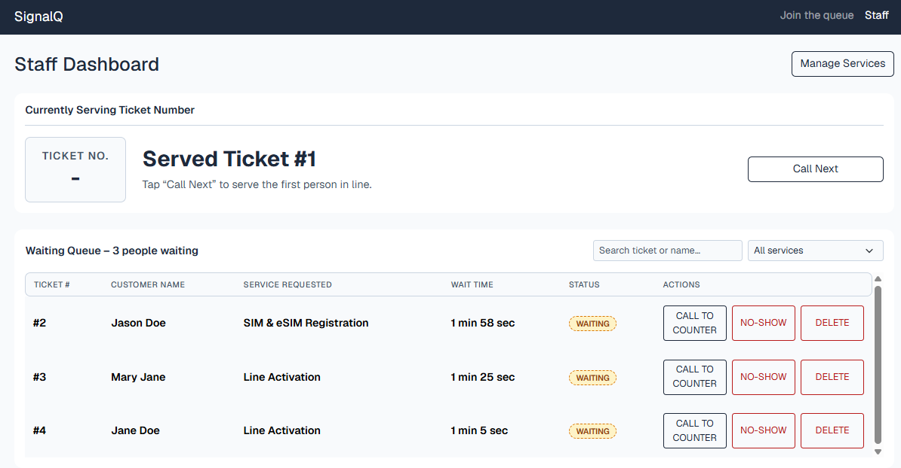

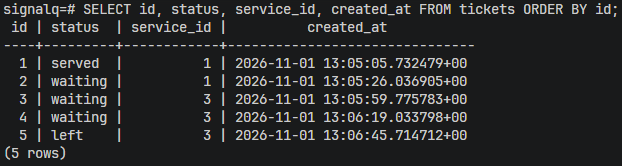

### After Restart

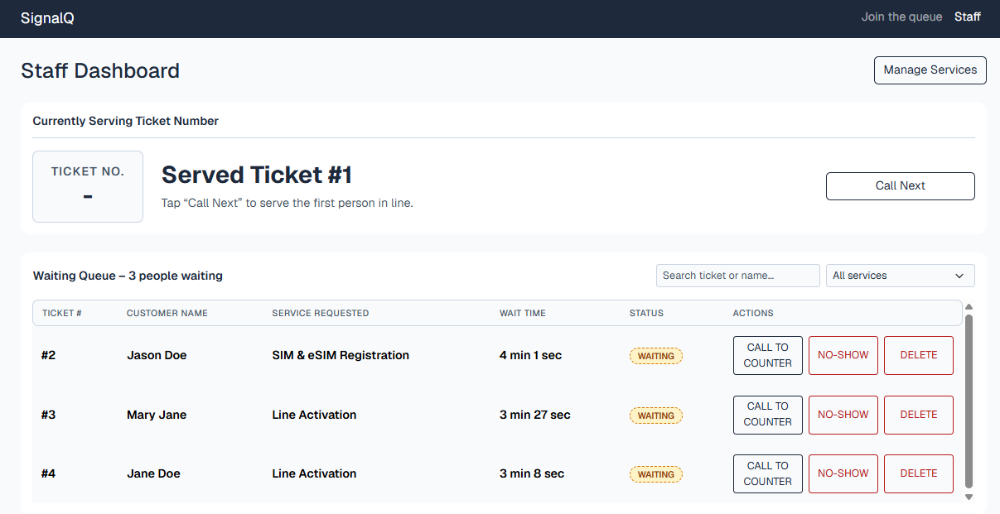

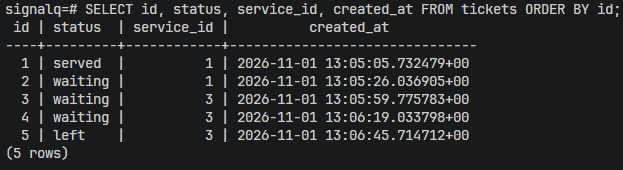

**Rebuild from scratch:** After deleting the Docker database volume and rebuilding the database using flask and seed data, all tables and seven services were successfully restored. I was able to join the queue, view the ticket on the Staff Dashboard, and access Manage Services without errors.

See [Persistence Test](persistence.md).

## 11. Reflection

**Hardest part of the week:** The hardest part of this week's work was designing the constraints for the database. The idea was to make them strict enough to ensure that the data is secure in case the validation process in the front end does not take place; however, at the same time, I did not want to make it too complex for it to become a hindrance. I went through my schema many times, and some things that I had missed included blanks in names, waiting tickets with call details, and one customer having two active tickets.

**Hardest requirement to make testable:**  NFR-02, which requires that tickets who join simultaneously never produce duplicate ticket numbers. It is hard to test because a race condition cannot be triggered reliably by clicking in a browser. 

**One report your staff persona would want from this data:** Michael would want a report of no-shows per service per day, next to the average time from `created_at` to `called_at` for each service. No-shows are the main reason his counter sits idle, so seeing which services and times of day have the most of them would help him and his supervisor decide when to call the next ticket early. The report uses only data SignalQ already stores: `status`, `service_id`, `created_at`, and `called_at`.

## 12. Declaration

I used ChatGPT to assist with understanding Flask-SQLAlchemy, PostgreSQL constraints, debugging, and documentation formatting. As well as, generating commands to test my database constraints against.
ProWritingAid was also used to check the grammar and style of the written documents.

The implementation was reviewed, tested, and adapted for SignalQ.

