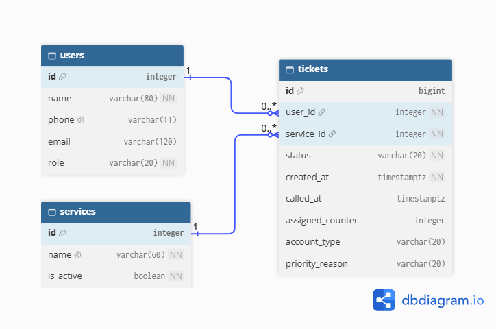

# SignalQ — Week 4 Schema Design

## Part 2a — Find the nouns in the requirements

The table below maps the data-storing functional requirements to database tables, columns, or computed values. The queue itself is not a separate table; it is formed from tickets ordered by their joining time.

| Req ID | Requirement (nouns in bold) | Nouns | Table or column? |
| --- | --- | --- | --- |
| FR-01 | A **customer** can join the **queue** by entering their **name**, **phone number**, **email** (optional), and **service** required. | Customer, queue, name, phone number, email, service | `users`, (queue is not a table), `users.name`, `users.phone`, `users.email`, `services` |
| FR-02 ★ | A **customer** can see their **ticket number**, **service**, **status**, **position**, assigned **counter**, and how long they have been **waiting**. | Customer, ticket number, service, status, position, counter, waiting duration | `tickets.id`, `tickets.service_id`, `tickets.status`, `tickets.assigned_counter`, `tickets.created_at`; position and waiting duration are computed |
| FR-03 | A **customer** can voluntarily leave the **queue**. | Customer, queue | `users`, (queue is not a table), `tickets.status` set to `'left'` (row kept, NFR-04)|
| FR-04 | A **staff member** can view all active waiting and called **tickets** with **number**, **service type**, and **status** in the **order** they joined. | Staff member, tickets, number, service type, status, order | `users.role`, `tickets`, `tickets.id`, `tickets.service_id`, `tickets.status`, `tickets.created_at` |
| FR-05 | A **staff member** can call a waiting **ticket** to their **counter**. | Staff member, ticket, counter | `users`, `tickets.status`, `tickets.assigned_counter` |
| FR-06 | A **staff member** can mark a **ticket** as served or a no-show. | Staff member, ticket, served, no-show | `users`, `tickets.status` |
| FR-07 | A **staff member** can add, rename, and deactivate a **service**. Deactivated **services** cannot accept new **tickets**, but existing **tickets** can still be served. | Staff member, service, services, tickets | `users`, `services`, `services.name`, `services.is_active`, `tickets.service_id` |
| FR-08 ★ | A **customer** can choose an **account type** (prepaid, postpaid or business) when joining the **queue**. | Customer, account type, queue | `users`, `tickets.account_type` |
| FR-09 ★ | A **staff member** can see each **ticket**’s **account type** next to its **service** on the **dashboard**. | Staff member, ticket, account type, service, dashboard | `users`, `tickets.account_type`, `tickets.service_id`; dashboard is UI |
| FR-10 ★ | A **customer** can request **priority** when joining the **queue** by choosing a **reason** (senior citizen, PWD or pregnant). | Customer, priority, queue, reason | `users`, `tickets.priority_reason` |
| FR-11 | A **staff member** can see which waiting **tickets** are **priority**. | Staff member, tickets, priority | `users`, `tickets.status`, `tickets.priority_reason` |

Several requirements reuse the same tables and columns. In particular, account type is stored once for FR-08 and FR-09, while priority reason is stored once for FR-10 and FR-11.

## Part 2b — List the tables and columns

| Table | Purpose |
| --- | --- |
| users | id, name, phone, email, role |
| services | id, name, is_active |
| tickets | id, user_id, service_id, status, created_at, called_at, assigned_counter, account_type, priority_reason |

**Computed values, not stored columns:**

- Queue position is calculated from active waiting tickets ordered by `created_at` (using the ticket ID to break ties).
- Waiting duration is calculated from `created_at`; for tickets already called, the time until `called_at` may be used to report their completed waiting duration.

## Part 2c — Choose types and constraints

| Table | Column | PostgreSQL type | Constraint | Why |
| --- | --- | --- | --- | --- |
| `users` | `id` | `integer GENERATED ALWAYS AS IDENTITY` | `PRIMARY KEY` | Unique identifier for each customer or staff member. |
| `users` | `name` | `varchar(80)` | `NOT NULL, CHECK (btrim(name) <> '')` | Stores the name entered by a customer (FR-01), or the name of a staff member. |
| `users` | `phone` | `varchar(11)` | `UNIQUE, CHECK (phone IS NULL OR phone ~ '^09[0-9]{9}$'), CHECK (role = 'staff' OR phone IS NOT NULL)` | Stores normalized Philippine mobile numbers (11 digits starting with 09) for FR-01. UNIQUE prevents duplicate customer records, so returning customers reuse their existing row. The first check rejects badly formatted numbers. The second makes the phone required for customers at the database level, while staff rows may leave it empty. |
| `users` | `email` | `varchar(120)` | `CHECK (email IS NULL OR email ~ '^[^@[:space:]]+@[^@[:space:]]+$')` | Optional customer email under FR-01. |
| `users` | `role` | `varchar(20)` | `NOT NULL DEFAULT 'customer', CHECK (role IN ('customer', 'staff'))` | Separates customer and staff roles. |
| `services` | `id` | `integer GENERATED ALWAYS AS IDENTITY` | `PRIMARY KEY` | Unique identifier for a telecom service. |
| `services` | `name` | `varchar(60)` | `NOT NULL UNIQUE, CHECK (btrim(name) <> '') ` | Prevents duplicate service names and supports adding or renaming a service (FR-07). |
| `services` | `is_active` | `boolean` | `NOT NULL DEFAULT TRUE` | Allows a service to be deactivated without deleting its records (FR-07, NFR-03). |
| `tickets` | `id` | `bigint GENERATED ALWAYS AS IDENTITY` | `PRIMARY KEY` | Database-generated ticket number; prevents duplicate IDs for simultaneous joins (NFR-02). |
| `tickets` | `user_id` | `integer` | `NOT NULL REFERENCES users(id) ON DELETE RESTRICT` | Connects a ticket to its customer; protects tickets if a user deletion is attempted (FR-01). |
| `tickets` | `service_id` | `integer` | `NOT NULL REFERENCES services(id) ON DELETE RESTRICT` | Connects a ticket to its requested service; historical tickets cannot be removed by deleting that service (FR-01, NFR-03). |
| `tickets` | `status` | `varchar(20)` | `NOT NULL DEFAULT 'waiting', CHECK (status IN ('waiting', 'called', 'served', 'no-show', 'left')), CHECK (status <> 'waiting' OR (called_at IS NULL AND assigned_counter IS NULL))` | Restricts statuses to the ticket states used by FR-02, FR-03, FR-05, and FR-06. |
| `tickets` | `created_at` | `timestamptz` | `NOT NULL DEFAULT now()` | Records when a customer joined; supports queue ordering and calculated waiting duration (FR-02, FR-04). |
| `tickets` | `called_at` | `timestamptz` | `NULL` | Records the time the ticket was called; remains `NULL` until that happens (FR-05). |
| `tickets` | `assigned_counter` | `integer` | `CHECK (assigned_counter IS NULL OR assigned_counter > 0)` | Stores the counter when a ticket is called (FR-02, FR-05); may be `NULL` while waiting. |
| `tickets` | `account_type` | `varchar(20)` | `CHECK (account_type IS NULL OR account_type IN ('prepaid', 'postpaid', 'business'))` | Planned for future FR-08 and FR-09; `NULL` until the account-type feature is implemented. |
| `tickets` | `priority_reason` | `varchar(20)` | `CHECK (priority_reason IS NULL OR priority_reason IN ('senior citizen', 'PWD', 'pregnant'))` | Planned for future FR-10 and FR-11; `NULL` until priority requests are implemented. |

**Table-level rules:**

| Rule | Definition | Why |
| --- | --- | --- |
| One active ticket per user | `CREATE UNIQUE INDEX unique_active_ticket_per_user ON tickets (user_id) WHERE status IN ('waiting', 'called');` |  This rule ensures a double tap, a second tab or a retry cannot give one customer two places in line, so each customer can have only one active ticket at a time. Finished tickets (served, no-show, left) are not counted, so a customer can join again later. |
| Prevent case-insensitive duplicate service names | `UNIQUE INDEX unique_service_name_ci ON lower(name)` | prevents duplicate service names regardless of capitalization.` |

## Part 2d — Draw the ERD

**Relationships:**

1. **Users → Tickets (1:N):** One user can have many tickets over time, but each ticket belongs to exactly one user. The foreign key `tickets.user_id` references `users.id`.

2. **Services → Tickets (1:N):** One service can have many tickets, but each ticket belongs to exactly one service. The foreign key `tickets.service_id` references `services.id`.

> **Note:** `account_type` and `priority_reason` are part of the schema, so they will exist in the database. However, no screen or route will use them this week, so they stay empty (`NULL`). They will be implemented in the succeeding weeks. The ERD also does not show the partial unique index `unique_active_ticket_per_user` on `tickets (user_id)`.

**Deletion Rules:**

| Foreign key | Rule | Reason |
| --- | --- | --- |
| `tickets.user_id` → `users.id` | `RESTRICT` | Prevents deleting a user while tickets still reference them, preserving the relationship between users and their ticket records (NFR-04). |
| `tickets.service_id` → `services.id` | `RESTRICT` | Deleting a service must not erase existing tickets or their service assignments (NFR-03). Staff can deactivate the service using `is_active = FALSE` instead (FR-07). |

## Part 2e — Check normalization

1. **1NF:** One value per cell (1NF): does any column hold a list, such as "Haircut, Shave"? 
    > No, every column stores a single value, not a list. 
2. **Depends on the whole key (2NF):** in each join table, does every extra column depend on both keys? 
    > Not applicable, because the schema has no join tables. All three tables have a single-column primary key, so every non-key column depends on the whole key and there are no partial dependencies.
3. **3NF:** would you ever have to update the same fact, such as a person's email or a service's name, in more than one row?
    > No, customer information is stored in users, service information is stored in services, and ticket-specific information is stored in tickets. The foreign keys tickets.user_id and tickets.service_id connect the tables without duplicating customer details or service names.

