# SignalQ — Week 4 Validation Report

**Activity:** Part 10 — Validation in Three Layers  
**Project:** SignalQ (Telecom Service-Center Queue System)  
**Date tested:** 11/1/2026


## 10b. Flask validation — bypass the browser

| Rule | Layer | How I tested it | What happened |
| --- | --- | --- | --- |
| Name and email must be valid; service must exist | Flask | POST with blank `name`, invalid `email`, and `service_id=999` | 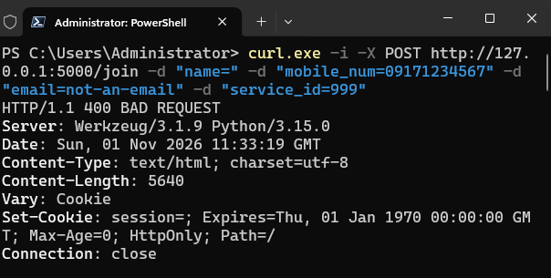 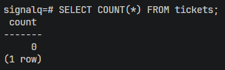 |
| Name must be at most 80 characters | Flask | POST with a 200-character name and otherwise valid values | 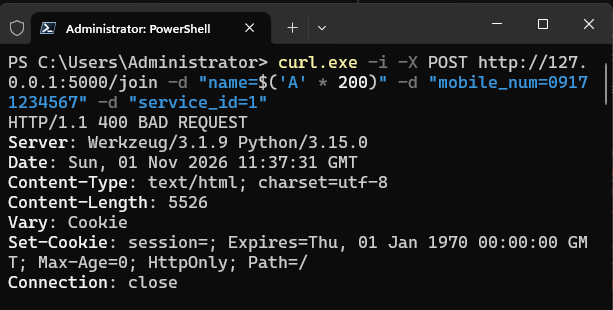 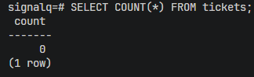 |
| An inactive service cannot be selected | Flask | POST with valid customer details and an inactive `service_id` | 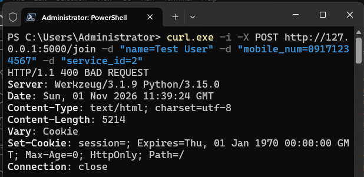 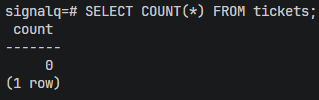 |

### Commands used

```powershell
# Invalid name, email, and nonexistent service
curl.exe -i -X POST http://127.0.0.1:5000/join -d "name=" -d "mobile_num=09171234567" -d "email=not-an-email" -d "service_id=999"

# Name longer than 80 characters (PowerShell)
curl.exe -i -X POST http://127.0.0.1:5000/join -d "name=$('A' * 200)" -d "mobile_num=09171234567" -d "service_id=1"

# First deactivate service ID 2 (SIM Card Replacement) in Manage Services; use its real ID here
curl.exe -i -X POST http://127.0.0.1:5000/join -d "name=Test User" -d "mobile_num=09171234567" -d "service_id=2"
```


## 10c. Database Validation

Tested PostgreSQL constraints directly using `psql`, bypassing Flask. Each invalid statement should return an error.

| Rule | Layer | How I tested it | What happened |
|---|---|---|---|
| Service must exist (FOREIGN KEY) | Database | Insert ticket with `service_id = 999` using a user with no active ticket | 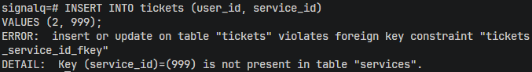 |
| Valid ticket status (CHECK) | Database | Update ticket status to `lost` | 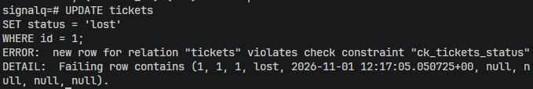 |
| Unique phone number (UNIQUE) | Database | Insert another user with an existing phone number | 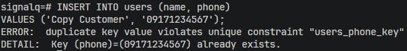 |
| Nonblank service name (CHECK) | Database | Insert service with name `'   '` | 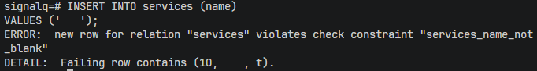 |
| Customer name required (NOT NULL) | Database | Insert user without a name | 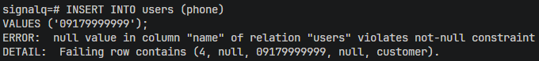 |
| Preserve ticket history (RESTRICT) | Database | Delete a service that has tickets | 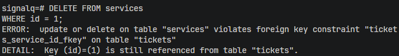 |


## 10d. SQL Safety

Checked the Python files for SQL statements constructed using f-strings.

```powershell
git grep -nE "f[\"'].*(SELECT|INSERT|UPDATE|DELETE)" -- "*.py"
```

**Expected result:** No matches, indicating no SQL f-strings were found.

**Actual result:** 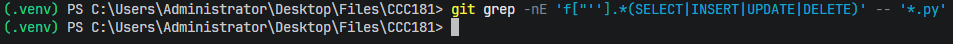

